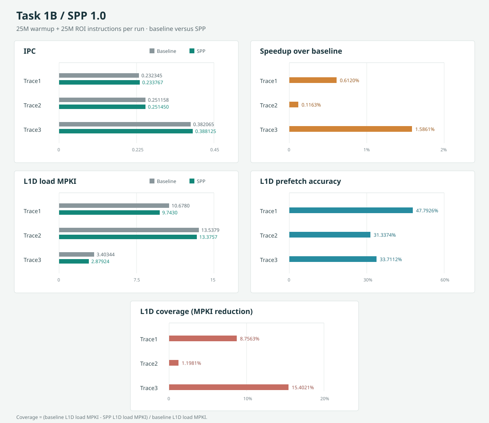

# Task 1B: SPP 1.0 - Simple Pattern Prefetcher

This branch contains two task commits:

- `04b0853 feat(prefetcher): add L1D stride-pattern prefetcher` adds an L1 data-cache prefetcher with per-instruction address/stride tracking, an eight-entry stride history, and uniform-versus-changing-stride modes. It tracks useful prefetches, adjusts the prefetch degree from measured accuracy, limits prefetches to the current page, and chooses the L1 or L2 fill level based on MSHR occupancy. In pattern mode, it currently predicts by repeating the most recent stride rather than replaying a learned multi-stride sequence.
- `ece8a00 build: add Docker build helper and usage docs` adds `mybuild.sh` to build ChampSim inside the repository's Docker image, with configurable prefetcher, replacement policy, and binary name. It also documents the helper and a sample SPP build and simulation command in `README2.md`.

Together, these changes add the SPP prefetcher and a documented, repeatable Docker-based build workflow for testing it.

## Task 1B Results

Each pair below uses the Task 1A no-prefetch baseline and Task 1B SPP run for the same trace. Both runs used 25M warmup instructions and 25M simulation instructions.

| Trace | IPC baseline | IPC SPP | Speedup | L1D load MPKI baseline | L1D load MPKI SPP | Prefetch accuracy | L1D coverage |
|---|---:|---:|---:|---:|---:|---:|---:|
| Trace1 | 0.232345 | 0.233767 | 0.6120% | 10.6780 | 9.7430 | 47.7926% | 8.7563% |
| Trace2 | 0.251158 | 0.251450 | 0.1163% | 13.5379 | 13.3757 | 31.3374% | 1.1981% |
| Trace3 | 0.382065 | 0.388125 | 1.5861% | 3.40344 | 2.87924 | 33.7112% | 15.4021% |

Speedup is $(IPC_{SPP}/IPC_{baseline}-1)\times100\%$. Prefetch accuracy is ChampSim's L1D accuracy (useful load prefetches divided by prefetches issued to the lower level); it is not reported for the baseline because no prefetcher is active. Coverage is the reduction in L1D load MPKI relative to baseline: $(MPKI_{baseline}-MPKI_{SPP})/MPKI_{baseline}\times100\%$. This paired-run MPKI definition measures the fraction of baseline load-miss rate eliminated by SPP.

The SPP final-stat accuracy counter is separate from ChampSim's L1D accuracy counter. It reports 48.7428%, 44.3280%, and 41.9949% for Trace1, Trace2, and Trace3, respectively. The degree controller uses this internal counter; each run ended at degree 2. The table above uses ChampSim's L1D accuracy for consistency with the simulator's reported prefetch statistics.

## Storage Overhead

The persistent SPP tables are the 64-entry per-IP tracker array and the 64-entry prefetch-usefulness history. The following is the logical field-width accounting from the C++ declarations; it excludes alignment padding.

| Structure / field | Bits per entry | Entries | Total bits |
|---|---:|---:|---:|
| Tracker: IP | 64 | 64 | 4,096 |
| Tracker: last cache-line address | 64 | 64 | 4,096 |
| Tracker: last stride | 64 | 64 | 4,096 |
| Tracker: eight stride-history values | 512 | 64 | 32,768 |
| Tracker: history length, history index, uniform confidence, pattern confidence, mode | 40 | 64 | 2,560 |
| Tracker: LRU value | 32 | 64 | 2,048 |
| Prefetch record: cache-line address and valid bit | 72 | 64 | 4,608 |
| **Persistent tables subtotal** |  |  | **54,272** |
| Global issued/useful counters and current degree | 160 | 1 | 160 |
| **Total logical SPP state** |  |  | **54,432 bits (6,804 bytes)** |

On a typical 64-bit C++ ABI, structure alignment adds padding: `SPP_TRACKER` occupies 104 bytes (832 bits) rather than its 97 bytes of fields, and `SPP_PREFETCH_RECORD` occupies 16 bytes (128 bits) rather than 9 bytes. That makes the two arrays 7,680 bytes; adding the 20 bytes of global counters gives 7,700 bytes of allocated SPP state (61,600 bits, about 7.52 KiB). This ABI allocation figure assumes 8-byte alignment for both structures. The four-element `recent` array used while predicting is temporary stack state, not part of the persistent tables. Cache lines and simulator queues are not included.

## Throttling Rationale

The controller starts at degree 4 while fewer than eight prefetches have been issued, then applies a monotonic accuracy schedule using its cumulative internal useful/issued ratio: degree 4 at accuracy at least 80%, degree 3 at at least 60%, degree 2 at at least 35%, and degree 1 below 35%. This keeps the minimum degree nonzero while reducing aggressiveness as observed usefulness falls; stronger accuracy earns more lookahead. The 35%, 60%, and 80% boundaries are heuristic design choices in this implementation, not thresholds selected by a documented sensitivity sweep. All three supplied runs finished at degree 2, consistent with their internal final accuracies falling in the 35%-to-60% range. A future tuning study should compare several threshold schedules and degrees against IPC, MPKI, accuracy, and coverage before claiming these boundaries are optimal.