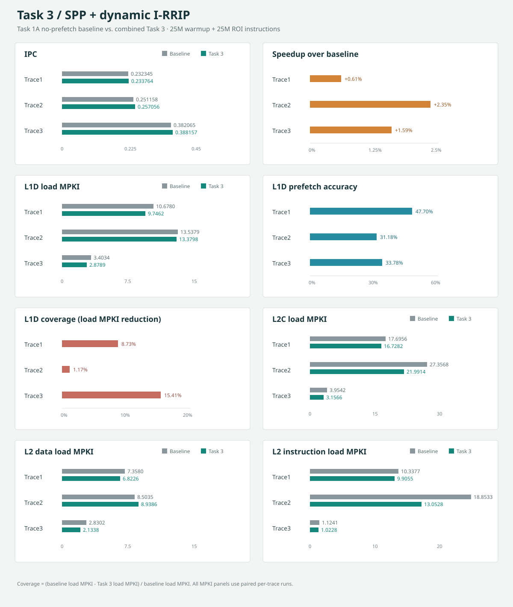
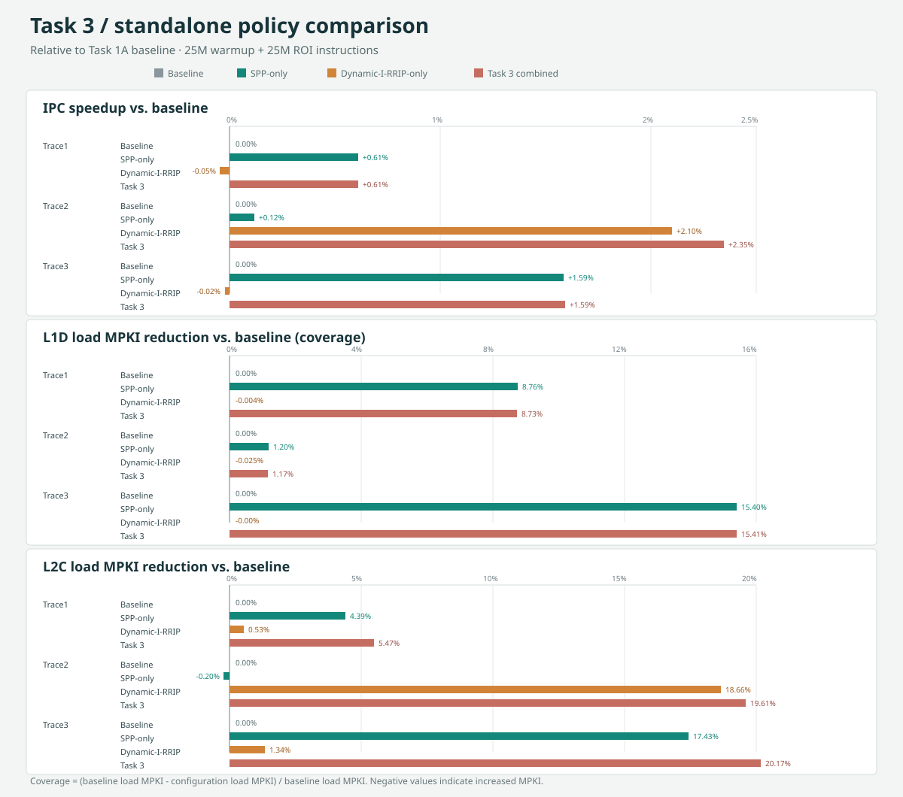

# Task 1B: SPP 1.0 - Simple Pattern Prefetcher

This branch contains two task commits:

- `04b0853 feat(prefetcher): add L1D stride-pattern prefetcher` adds an L1 data-cache prefetcher with per-instruction address/stride tracking, an eight-entry stride history, and uniform-versus-changing-stride modes. It tracks useful prefetches, adjusts the prefetch degree from measured accuracy, limits prefetches to the current page, and chooses the L1 or L2 fill level based on MSHR occupancy. In pattern mode, it currently predicts by repeating the most recent stride rather than replaying a learned multi-stride sequence.
- `ece8a00 build: add Docker build helper and usage docs` adds `mybuild.sh` to build ChampSim inside the repository's Docker image, with configurable prefetcher, replacement policy, and binary name. It also documents the helper and a sample SPP build and simulation command in `README2.md`.

Together, these changes add the SPP prefetcher and a documented, repeatable Docker-based build workflow for testing it.

## Task 1A: IP-Stride Prefetcher Understanding

The provided IP-stride prefetcher tracks memory behavior per instruction pointer (IP). It first shifts the IP right by masking off all but its lowest eight bits, then searches a 24-entry tracker table for that IP. A new IP replaces the least-recently-used tracker and initializes its last cache-line address and stride. For a tracked IP, it computes the signed distance in cache lines from the previous address. Zero strides do not trigger a prefetch. A prefetch is issued only when the new stride matches the previous stride, which provides basic confidence that the IP is following a constant-stride stream.

After detecting the repeated stride, the prefetcher generates three future addresses at one, two, and three stride steps from the current line. It stops when a candidate would cross the current 4 KiB page. If the MSHR occupancy is below half capacity, it requests an L1 fill; otherwise, it requests an L2 fill. It then updates the tracker's address, stride, and LRU position. Thus, this is a fixed-degree constant-stride predictor: it does not learn repeating sequences of different strides. Masking the IP to eight bits also means distinct instruction pointers can alias to the same tracker.

## Task 1B: SPP Logic

### Intended prediction logic

The assignment's non-uniform requirement calls for predicting a repeating sequence of strides, not just detecting that consecutive strides differ. For each IP, the conceptual design is:

1. Track the most recent cache-line address and derive each new signed stride in cache-line units.
2. Prefer uniform prediction when the same nonzero stride repeats with sufficient confidence. Generate multiple lookahead addresses using that stride.
3. If strides stop repeating uniformly, use the recent stride sequence to predict the next stride. Learn which stride follows each sequence, then repeat this process to predict multiple future addresses.
4. Check every candidate against the current 4 KiB page before issuing it. Avoid crossing the page boundary. Select the fill level based on resource pressure, and update usefulness/accuracy counters so the prefetch degree can be throttled.

### Behavior in this implementation

The current SPP code maintains 64 per-IP trackers, each with an eight-stride circular history, uniform and pattern confidence counters, a mode, and LRU state. Repeated strides select uniform mode. A changed stride raises pattern confidence, and two changes select pattern mode. It tracks up to four recent stride values, but does not use them as a signature lookup: the non-uniform path selects the most recent stride and repeats it for each prefetch degree. Therefore, it does not yet learn or replay a repeating multi-stride sequence such as $(+1,+2,+2,+2,+3)$. It also enters the history-based prediction path once two strides have been recorded, even if pattern mode has not been confirmed. This is an implementation limitation relative to the intended signature-to-next-stride behavior above.

Both prediction paths are constrained to the same page as the demand access. Prefetches target L1 while MSHR occupancy is below half capacity and L2 otherwise. A 64-entry global address history counts a prefetch as useful when that line is later accessed; the cumulative internal useful/issued ratio selects degree 4, 3, 2, or 1 at the configured accuracy thresholds. The LRU tracker table bounds the number of simultaneously tracked IPs.

## Task 1B Results

Each pair below uses the Task 1A no-prefetch baseline and Task 1B SPP run for the same trace. Both runs used 25M warmup instructions and 25M simulation instructions.

| Trace | IPC baseline | IPC SPP | Speedup | L1D load MPKI baseline | L1D load MPKI SPP | Prefetch accuracy | L1D coverage |
|---|---:|---:|---:|---:|---:|---:|---:|
| Trace1 | 0.232345 | 0.233767 | 0.6120% | 10.6780 | 9.7430 | 47.7926% | 8.7563% |
| Trace2 | 0.251158 | 0.251450 | 0.1163% | 13.5379 | 13.3757 | 31.3374% | 1.1981% |
| Trace3 | 0.382065 | 0.388125 | 1.5861% | 3.40344 | 2.87924 | 33.7112% | 15.4021% |

Speedup is $(IPC_{SPP}/IPC_{baseline}-1)\times100\%$. Prefetch accuracy is ChampSim's L1D accuracy (useful load prefetches divided by prefetches issued to the lower level); it is not reported for the baseline because no prefetcher is active. Coverage is the reduction in L1D load MPKI relative to baseline: $(MPKI_{baseline}-MPKI_{SPP})/MPKI_{baseline}\times100\%$. This paired-run MPKI definition measures the fraction of baseline load-miss rate eliminated by SPP.

The SPP final-stat accuracy counter is separate from ChampSim's L1D accuracy counter. It reports 48.7428%, 44.3280%, and 41.9949% for Trace1, Trace2, and Trace3, respectively. The degree controller uses this internal counter; each run ended at degree 2. The table above uses ChampSim's L1D accuracy for consistency with the simulator's reported prefetch statistics.

## Storage Overhead

The persistent SPP tables are the 64-entry per-IP tracker array and the 64-entry prefetch-usefulness history. The following is the logical field-width accounting from the C++ declarations; it excludes alignment padding.

| Structure / field | Bits per entry | Entries | Total bits |
|---|---:|---:|---:|
| Tracker: IP | 64 | 64 | 4,096 |
| Tracker: last cache-line address | 64 | 64 | 4,096 |
| Tracker: last stride | 64 | 64 | 4,096 |
| Tracker: eight stride-history values | 512 | 64 | 32,768 |
| Tracker: history length, history index, uniform confidence, pattern confidence, mode | 40 | 64 | 2,560 |
| Tracker: LRU value | 32 | 64 | 2,048 |
| Prefetch record: cache-line address and valid bit | 72 | 64 | 4,608 |
| **Persistent tables subtotal** |  |  | **54,272** |
| Global issued/useful counters and current degree | 160 | 1 | 160 |
| **Total logical SPP state** |  |  | **54,432 bits (6,804 bytes)** |

On a typical 64-bit C++ ABI, structure alignment adds padding: `SPP_TRACKER` occupies 104 bytes (832 bits) rather than its 97 bytes of fields, and `SPP_PREFETCH_RECORD` occupies 16 bytes (128 bits) rather than 9 bytes. That makes the two arrays 7,680 bytes; adding the 20 bytes of global counters gives 7,700 bytes of allocated SPP state (61,600 bits, about 7.52 KiB). This ABI allocation figure assumes 8-byte alignment for both structures. The four-element `recent` array used while predicting is temporary stack state, not part of the persistent tables. Cache lines and simulator queues are not included.

## Throttling Rationale

The controller starts at degree 4 while fewer than eight prefetches have been issued, then applies a monotonic accuracy schedule using its cumulative internal useful/issued ratio: degree 4 at accuracy at least 80%, degree 3 at at least 60%, degree 2 at at least 35%, and degree 1 below 35%. This keeps the minimum degree nonzero while reducing aggressiveness as observed usefulness falls; stronger accuracy earns more lookahead. The 35%, 60%, and 80% boundaries are heuristic design choices in this implementation, not thresholds selected by a documented sensitivity sweep. All three supplied runs finished at degree 2, consistent with their internal final accuracies falling in the 35%-to-60% range. A future tuning study should compare several threshold schedules and degrees against IPC, MPKI, accuracy, and coverage before claiming these boundaries are optimal.

# Task 2A: Instruction-Conscious L2 Replacement Policy (I-RRIP)

## 1. Overview of RRPV

The implementation uses Re-Reference Prediction Value (RRPV) to estimate the likelihood of a cache line being accessed again. With `maxRRPV = 3`, RRPV ranges from 0 to 3.

| RRPV | Meaning |
|---:|---|
| 0 | Strong protection; predicted near-term reuse |
| 1 | Relatively high protection |
| 2 | Lower protection |
| 3 | Eligible for eviction |

The policy modifies conventional SRRIP to prioritize instruction lines over data lines while retaining the core RRIP replacement mechanism.

## 2. Insertion Logic

For a cache miss, the incoming line receives RRPV 1 if it is an instruction and RRPV 2 if it is data.

**Rationale:** Conventional SRRIP inserts lines at `maxRRPV - 1` (2). This conservative insertion avoids excessively protecting lines that may never be reused. I-RRIP assigns instruction lines a lower initial RRPV to reduce their likelihood of early eviction, particularly when instruction reuse is high.

## 3. Promotion Logic

On a cache hit, instruction lines receive RRPV 0, while data lines receive RRPV 1.

**Rationale:** A hit suggests that the line may be reused. Conventional SRRIP promotes both types of lines to RRPV 0, but I-RRIP gives instruction lines stronger protection. Data lines remain protected, although they are closer to becoming eviction candidates.

This distinction can benefit workloads with frequently executed code, such as loops. However, it may disadvantage workloads with highly reusable data. The best promotion values depend on workload characteristics.

## 4. Eviction Logic

Victim selection follows two preferences:

1. Select a non-instruction line whose RRPV equals `maxRRPV`.
2. If no such line exists, select any line whose RRPV equals `maxRRPV`.

**Rationale:** Conventional SRRIP selects the first line with maximum RRPV, regardless of its type. I-RRIP adds an instruction-aware preference while retaining RRPV as the primary eviction criterion.

For example, if both an instruction line and a data line have RRPV 3, the data line is preferred. If all eligible candidates are instruction lines, the fallback ensures that replacement can still proceed.

This protects instruction lines without making them immune to eviction.

## 5. Aging and Invalid-Way Handling

When no line has reached maximum RRPV, the algorithm increments all RRPVs below 3 and searches again. This preserves the core RRIP mechanism and allows stale instruction lines to become eviction candidates.

The implementation also checks for invalid ways first. An invalid way can accommodate a new line without evicting existing data, avoiding unnecessary replacement work.

## 6. Summary of Design Decisions

| Component | Decision | Rationale |
|---|---|---|
| Insertion | Modified | Instruction lines start at RRPV 1; data lines at 2 |
| Promotion | Modified | Instruction hits receive RRPV 0; data hits receive 1 |
| Victim selection | Modified | Prefer eligible data lines over instruction lines |
| Aging | Retained | Preserve RRIP-based reuse prediction |
| Invalid-way handling | Retained | Avoid evicting valid lines unnecessarily |

## 7. Expected Benefits and Limitations

I-RRIP may improve instruction retention, reduce instruction-cache misses, and improve IPC when instruction reuse is important. However, stronger instruction protection can evict frequently reused data, potentially increasing data-cache misses.

Evaluate the policy against conventional SRRIP using identical workloads and simulator configurations. Measure:

- L2 instruction and data miss rates.
- Overall L2 miss rate.
- IPC and execution cycles.
- Total simulation time.

**Note:** This implementation is a fixed instruction-aware policy, unlike dynamic I-RRIP, which uses leader-set statistics to choose between replacement policies. Here, instruction-aware insertion, promotion, and victim selection are always active.

# Task 2B: Dynamic I-RRIP

## 1. Overview

Dynamic RRIP adapts the cache insertion policy based on workload behavior rather than using a fixed policy for all cache sets. In this implementation, the policy switches between standard SRRIP and instruction-aware RRIP based on observed instruction-access pressure.

## 2. Choice of Leader Sets

The implementation uses a leader-set stride of **32**, selecting approximately **1 out of every 32 sets (3.125%)** as leader sets.

The rationale is to collect workload statistics while keeping monitoring overhead low and leaving most cache sets available for normal operation. Too few leader sets may produce unrepresentative statistics, while too many reduce the number of follower sets. A stride of 32 is a practical design choice whose effectiveness should be validated experimentally.

## 3. Decision Logic

The policy uses instruction-access pressure to decide which insertion policy follower sets should use.

The pressure metric is:

$$
P = \frac{I_A + I_M}{A + M}
$$

Where:

- $I_A$: Instruction accesses observed by leader sets.
- $I_M$: Instruction misses observed by leader sets.
- $A$: Total accesses observed by leader sets.
- $M$: Total misses observed by leader sets.

The policy-selection rule is:

- If $P \leq 0.25$, select SRRIP.
- If $P > 0.25$, select instruction-aware RRIP.

The threshold of **0.25** requires instruction pressure to exceed 25% before switching to instruction-aware RRIP.

- **Low instruction pressure:** SRRIP avoids unnecessarily favoring instruction lines.
- **High instruction pressure:** Instruction-aware RRIP provides greater protection for instruction lines against eviction.
- **Initial state:** The policy defaults to SRRIP until accesses are observed.

**Implementation note:** Verify whether instruction misses are already included in instruction accesses. If so, adding them again double-counts misses. If total accesses include both instruction and data accesses, a conventional instruction-access fraction would instead be:

$$
P = \frac{I_A}{A}
$$

## 4. Summary and Evaluation

The design samples approximately 3.125% of cache sets and uses instruction pressure to select the policy for follower sets. This is a threshold-based adaptive I-RRIP design rather than conventional D-RRIP, which typically uses SRRIP and BRRIP leader sets with a policy-selection counter.

Evaluate the stride and threshold experimentally using L2 miss rate, IPC, and execution cycles. Compare alternative settings to determine whether they improve performance across different workloads.

# Task 3: SPP-Aware Dynamic I-RRIP

## Evaluation Against the Task 1A Baseline

The table compares the no-prefetch Task 1A baseline with the combined Task 3 configuration (L1D SPP plus dynamic I-RRIP at L2). Each pair uses the same trace and 25M warmup plus 25M ROI instructions. `Speedup` is the IPC ratio; the percentage in parentheses is the IPC improvement over baseline. Baseline prefetch accuracy is N/A because no prefetcher ran.

| Trace | Baseline IPC | Task 3 IPC | Speedup vs. baseline | L1D SPP accuracy | L2C prefetch accuracy |
|---|---:|---:|---:|---:|---:|
| Trace1 | 0.232345 | 0.233764 | 1.0061x (+0.61%) | 47.7047% | 2.0935% |
| Trace2 | 0.251158 | 0.257056 | 1.0235x (+2.35%) | 31.1806% | 1.9955% |
| Trace3 | 0.382065 | 0.388157 | 1.0159x (+1.59%) | 33.7758% | 1.8402% |

The primary prefetch accuracy is ChampSim's L1D accuracy: useful load prefetches divided by prefetches issued to the lower level. The optional L2C accuracy is the corresponding reported L2C prefetch statistic; it is low and should not be confused with the L1D SPP accuracy or the SPP's separate internal useful/issued counter.

### Load MPKI and Coverage

| Trace | L1D load MPKI baseline | L1D load MPKI Task 3 | L2C load MPKI baseline | L2C load MPKI Task 3 | L2 data load MPKI baseline | L2 data load MPKI Task 3 | L2 instruction load MPKI baseline | L2 instruction load MPKI Task 3 |
|---|---:|---:|---:|---:|---:|---:|---:|---:|
| Trace1 | 10.6780 | 9.7462 | 17.6956 | 16.7282 | 7.3580 | 6.8226 | 10.3377 | 9.9055 |
| Trace2 | 13.5379 | 13.3798 | 27.3568 | 21.9914 | 8.5035 | 8.9386 | 18.8533 | 13.0528 |
| Trace3 | 3.4034 | 2.8789 | 3.9542 | 3.1566 | 2.8302 | 2.1338 | 1.1241 | 1.0228 |

Coverage below is calculated for each reported level as `(baseline load MPKI - Task 3 load MPKI) / baseline load MPKI`. Positive values mean fewer load misses per thousand instructions; negative values mean the miss rate increased. The L2 component changes include both SPP traffic and the replacement-policy change, so they are comparative outcomes rather than isolated prefetch coverage.

| Trace | L1D coverage | L2C load MPKI reduction | L2 data load MPKI reduction | L2 instruction load MPKI reduction |
|---|---:|---:|---:|---:|
| Trace1 | 8.73% | 5.47% | 7.28% | 4.18% |
| Trace2 | 1.17% | 19.61% | -5.12% | 30.77% |
| Trace3 | 15.41% | 20.17% | 24.61% | 9.01% |

### Prefetch-Aware Replacement Rationale

The L2 replacement update checks the incoming request type before applying the normal dynamic I-RRIP update. When `type == PREFETCH`, a newly inserted line is assigned `maxRRPV` (3), making it the first eviction candidate, and the update returns without applying demand-hit promotion or updating the leader-set instruction/data counters. The design treats a prefetch as speculative: it should not displace a line already shown to be useful, and its arrival should not bias the demand-trained policy selector.

If a later demand access hits that prefetched line, the request is no longer typed as `PREFETCH`; the normal replacement update then promotes it according to the active policy. This allows useful prefetches to earn protection through demonstrated demand reuse, while unused prefetches remain easy to evict. Leader sets continue to sample demand behavior for SRRIP, while follower sets use the dynamic instruction-priority decision, so prefetch traffic does not distort the set-dueling signal.

This is a conservative policy: a useful prefetch can still be evicted before demand arrives. The tradeoff is intentional because protecting every speculative line would let inaccurate prefetch streams pollute L2 and evict demand-fetched instruction or data lines.

### Interpretation and Comparison Limit

Against the Task 1A baseline, the combined Task 3 configuration improves IPC on all three traces. Compared directly with dynamic-I-RRIP-only, it also improves IPC on all three traces. Against standalone SPP, it is effectively tied on Trace1 and Trace3, and is 0.0013% lower on Trace1; therefore, these results do not support a strict claim that Task 3 outperforms standalone SPP on every trace. The Task 3 L2 data MPKI is also higher than SPP-only on Trace1 and Trace3, although the combined configuration reduces total L2 load MPKI on those traces. Report the small IPC differences as measured rather than treating them as meaningful wins without repeated-run variability analysis.

## Task 3 Comparison with Standalone Policies

The following comparison uses the Task 1A baseline, Task 1B SPP-only runs, Task 2B dynamic-I-RRIP-only runs, and combined Task 3 runs. Each run uses 25M warmup and 25M simulation instructions. Speedup is relative to the matching Task 1A baseline, while the final two columns directly compare Task 3 IPC to each standalone configuration.

| Trace | SPP-only IPC (speedup) | Dynamic-I-RRIP-only IPC (speedup) | Task 3 IPC (speedup) | Task 3 vs. SPP IPC | Task 3 vs. dynamic-I-RRIP IPC |
|---|---:|---:|---:|---:|---:|
| Trace1 | 0.233767 (1.0061x) | 0.232236 (0.9995x) | 0.233764 (1.0061x) | -0.0013% | +0.6580% |
| Trace2 | 0.251450 (1.0012x) | 0.256435 (1.0210x) | 0.257056 (1.0235x) | +2.2295% | +0.2422% |
| Trace3 | 0.388125 (1.0159x) | 0.381975 (0.9998x) | 0.388157 (1.0159x) | +0.0082% | +1.6184% |

L1D prefetch accuracy below is ChampSim's `L1D USEFUL LOAD PREFETCHES` accuracy field; it is N/A when SPP is disabled. L1D coverage is `(Task 1A baseline L1D load MPKI - configuration L1D load MPKI) / Task 1A baseline L1D load MPKI`. Negative coverage indicates a small increase in L1D load MPKI.

| Trace | Configuration | L1D load MPKI | L1D SPP accuracy | L1D coverage |
|---|---|---:|---:|---:|
| Trace1 | SPP-only | 9.7430 | 47.7926% | 8.7563% |
| Trace1 | Dynamic-I-RRIP-only | 10.6784 | N/A | -0.0037% |
| Trace1 | Task 3 combined | 9.7462 | 47.7047% | 8.7264% |
| Trace2 | SPP-only | 13.3757 | 31.3374% | 1.1981% |
| Trace2 | Dynamic-I-RRIP-only | 13.5413 | N/A | -0.0251% |
| Trace2 | Task 3 combined | 13.3798 | 31.1806% | 1.1678% |
| Trace3 | SPP-only | 2.8792 | 33.7112% | 15.4021% |
| Trace3 | Dynamic-I-RRIP-only | 3.4035 | N/A | -0.0012% |
| Trace3 | Task 3 combined | 2.8789 | 33.7758% | 15.4126% |

| Trace | Configuration | L2C load MPKI | L2 data load MPKI | L2 instruction load MPKI |
|---|---|---:|---:|---:|
| Trace1 | SPP-only | 16.9189 | 6.5280 | 10.3909 |
| Trace1 | Dynamic-I-RRIP-only | 17.6013 | 7.6895 | 9.9118 |
| Trace1 | Task 3 combined | 16.7282 | 6.8226 | 9.9055 |
| Trace2 | SPP-only | 27.4117 | 8.3558 | 19.0558 |
| Trace2 | Dynamic-I-RRIP-only | 22.2530 | 9.1060 | 13.1470 |
| Trace2 | Task 3 combined | 21.9914 | 8.9386 | 13.0528 |
| Trace3 | SPP-only | 3.2648 | 2.1090 | 1.1558 |
| Trace3 | Dynamic-I-RRIP-only | 3.9013 | 2.8730 | 1.0282 |
| Trace3 | Task 3 combined | 3.1566 | 2.1338 | 1.0228 |

